# Perturbench: predicting unseen double perturbations in single-cell data

This repository is a small benchmark for single-cell perturbation prediction and try to answer one question:
Can a CPA-style (Compositional Perturbation Autoencoder) conditional VAE (Variational AutoEncoder) predict the effect of a double gene perturbation that it never saw in training?
We compare the model with two simple baselines on the Norman 2019 dataset.

**Answer.**
No CPA variant beats the additive baseline in this setup.
The best CPA variant is close to additive but not better.
The best CPA variant depends strongly on how similar a test pair is to the training perturbations. Additive depends on this much less.

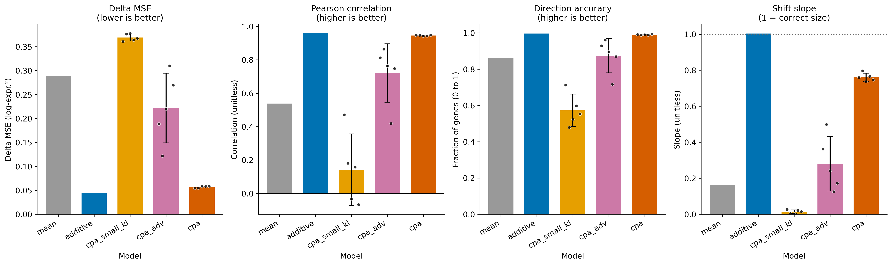

*Figure 1. Test-set results on Norman 2019. Bars show the mean over 5 seeds of the per-seed mean over 39 test perturbations. Error bars show the standard deviation over seeds, and dots show single seeds. The mean and additive baselines are deterministic and have no error bars.*

## Key findings

1. The additive baseline is the best model on all four metrics.
2. The best CPA variant is `cpa`. Its mean MSE is 0.057 and the additive MSE is 0.045.
3. The MSE gap between `cpa` and additive is not reliable. The 95% bootstrap interval is -0.009 to +0.035 and includes 0.
4. Two perturbations cause 94% of the summed MSE gap. Without them, the mean gap is 0.0008. We found these two after looking at the data, so this result is exploratory.
5. The Pearson gap is small but its interval excludes 0. CPA is 0.014 lower than additive, with an interval of -0.028 to -0.002.
6. The best CPA variant has a KL weight of 30. Its latent vector holds no information about the cell. It works as a network that maps a perturbation to an expression profile.
7. CPA with a small KL weight reconstructs cells well but predicts almost no perturbation shift. It is worse than the mean baseline.
8. An adversary raises the predicted shift of the small-KL model. The result is unstable. One of five seeds scores worse than the mean baseline.
9. The performance of `cpa` depends on the similarity of a test pair to the training deltas. The Spearman correlation with similarity is +0.84 for Pearson and -0.76 for MSE. For additive, the MSE trend is not significant.
10. The worst pairs of `cpa` are not strongly non-additive. Four of them rank 8, 23, 26 and 28 of 39 by interaction strength. Each of the five worst pairs contains a gene that appears in no training double.
11. `cpa` learns part of the non-additive effect. The correlation between its deviation from the scaled additive prediction and the true deviation is +0.39, with an interval of +0.24 to +0.54. This does not lower its MSE. It is 0.030 higher than additive in the weak-interaction half and not different in the strong half.
12. The perturbation embeddings of `cpa` encode the similarity of expression deltas. The Spearman correlation is +0.79 in all five seeds. For `cpa_small_kl` it is +0.03.

These results agree with the finding of [Ahlmann-Eltze, Huber and Anders](https://www.nature.com/articles/s41592-025-02772-6) that simple additive models are hard to beat.
Our setting is small.
It has one dataset, one data split and 39 test perturbations.
So our results agree with their claim and do not confirm it.

## Terms

| Term | Meaning |
|---|---|
| Perturbation | A gene that the experiment switches on. A double perturbation switches on two genes in one cell. |
| Delta | The mean expression of a perturbed group minus the mean expression of the control cells. |
| Additive baseline | Predicts the delta of a double as the sum of the two single deltas. |
| Mean baseline | Predicts the average expression of all perturbed training cells for every perturbation. |
| Latent vector | A short vector of 64 numbers. It stores what the encoder keeps about a cell. |
| KL divergence | A penalty that pulls the latent vector toward a standard Gaussian distribution. It limits how much information the latent vector holds. |
| Posterior collapse | The encoder output stops depending on the cell. The KL divergence is close to zero. |
| Discriminator | A classifier that tries to predict the perturbation from the latent vector. |
| Seed | A number that fixes the random choices of one run. |
| Bootstrap interval | An interval from resampling the 39 test perturbations with replacement 10,000 times. |
| Cosine similarity | A number from -1 to 1. It measures whether two vectors point in the same direction. |
| Similarity to training | For a test pair, the largest cosine similarity between its true delta and the delta of any training perturbation. We leave out the two single perturbations of the pair itself. |
| Interaction strength | The norm of (true delta minus additive delta) divided by the norm of the true delta, on the top 20 genes. A value of 0 means the pair is perfectly additive. |
| Scaled additive | The additive prediction multiplied by one factor. The factor is fitted on the 77 training doubles. It is 0.796. |
| Residual correlation | The correlation between (prediction minus additive) and (truth minus additive). It tests whether a model captures the non-additive part. |
| Spearman correlation | A correlation of ranks. It measures whether two quantities rise together, without assuming a straight line. |

## Data

We use the Norman 2019 Perturb-seq dataset from the scPerturb collection.
It uses K562 cells and CRISPR activation.
Each perturbation switches on one or two genes.

| Item | Value |
|---|---|
| Raw file | 111,445 cells and 33,694 genes |
| Perturbations in the raw file | 237 |
| Dropped perturbations | 5, with 1,798 cells |
| Final dataset | 109,647 cells and 2,065 genes |
| Final perturbations | 102 singles, 129 doubles and 1 control |
| Control cells | 11,855 |

We dropped 5 perturbations because one target gene is missing from the gene list.
The missing genes are `C19orf26`, `C3orf72` and `KIAA1804`.
They probably have a new name in the gene list, but we did not find it.

Singles have more cells than doubles.
A single has 553 cells on average and a double has 321.

Figure 2 shows the dataset.
Control cells concentrate in the center of the UMAP.
Some groups at the edges contain almost no control cells.
UMAP is a method that places similar cells close together on a 2D plane.

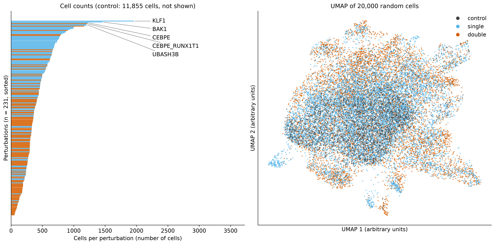

*Figure 2. Cells per perturbation, left, and a UMAP of 20,000 random cells colored by perturbation type, right.*

## Methods

### Preprocessing

1. Normalize each cell to 10,000 counts.
2. Apply `log1p`.
3. Select the 2,000 most highly variable genes. These are genes whose expression varies more than expected for their mean level.
4. Add every perturbed gene that is not already selected. This gives 2,065 genes.

All models predict in this log-normalized space.
Gene selection uses all cells, including test cells.
It does not use perturbation labels.

### Split

The split works on perturbations, not on cells.
All cells of one perturbation go into the same set.
The split seed is 0 and is separate from the model seeds.

| Set | Perturbations | Cells |
|---|---|---|
| Train | Control, 102 singles and 77 doubles | 93,491 |
| Validation | 13 doubles | 4,208 |
| Test | 39 doubles | 11,948 |

Both genes of every validation and test double appear as singles in training.
The pair itself does not.
The function `make_split` raises an error if this rule is broken.

### Metrics

For each test perturbation, we select the 20 genes with the largest absolute true delta.
The metrics use these 20 genes.
The control mean comes from the training control cells.
We report two gene lists.
One list includes the perturbed genes themselves and one excludes them.
The figures use the list that includes them.

| Metric | Meaning |
|---|---|
| MSE | Mean squared difference between predicted and true delta. Lower is better. |
| Pearson | Correlation between predicted and true delta across the 20 genes. Higher is better. |
| Direction accuracy | Fraction of the 20 genes where the signs of predicted and true delta agree. |
| Slope | The dot product of predicted and true delta divided by the squared norm of the true delta. A value of 1 means the predicted shift has the right size. |

We compute all metrics on deltas.
Raw expression is dominated by genes that never change.

### Models

**Mean baseline.**
It predicts the average expression of all perturbed training cells.
The average is over cells, so perturbations with many cells have more weight.

**Additive baseline.**
It predicts the control mean plus the shift of gene A plus the shift of gene B.
Each shift is the mean of the single-perturbed cells minus the control mean.
Training doubles are not used.

**CPA variants.**
All variants share one architecture.

- The encoder is a multilayer perceptron with two hidden layers of 512 units and ReLU. It outputs the mean and the log variance of a 64-dimensional latent vector.
- The perturbation embedding is a linear layer without bias. Its input is a multi-hot vector over the 102 perturbed genes. A double perturbation gets the sum of two single embeddings.
- The decoder is a multilayer perceptron with two hidden layers of 512 units. It maps the sum of the basal latent vector and the embedding back to 2,065 genes.
- The loss is squared error summed over genes plus the KL weight times the KL divergence. The variance is fixed.
- At prediction time, the model encodes control cells and adds the embedding of the new perturbation. It decodes 1,000 cells and averages them.

The three frozen variants differ in two settings.

| Variant | KL weight | Adversary weight |
|---|---|---|
| `cpa` | 30 | 0 |
| `cpa_small_kl` | 0.001 | 0 |
| `cpa_adv` | 0.001 | 100 |

All variants use latent size 64, learning rate 3e-4, batch size 512 and Adam.
They train for 100 epochs without early stopping.
We use the weights of the last epoch.

**Adversary.**
A discriminator with two hidden layers of 128 units predicts the perturbation from the basal latent vector.
It trains with binary cross-entropy.
The encoder receives a confusion loss.
This loss is the binary cross-entropy between the discriminator output and the base rate of each perturbed gene.
It is smallest when the discriminator output carries no information about the perturbation.
The original CPA maximizes the discriminator error instead.
We chose the bounded loss for stability.

### Hyperparameter selection

We selected all settings on the 13 validation perturbations.
The test set was not used for selection.
The score is the validation MSE, averaged over the last 10 epochs where noted.

**KL weight.**
Larger weights reduce the information in the latent vector and raise the predicted shift.

| KL weight | Epochs | Validation KL | Slope | Validation MSE |
|---|---|---|---|---|
| 0.001 | 50 | 263 | 0.012 | 0.648 |
| 0.01 | 50 | 135 | 0.039 | 0.625 |
| 0.1 | 50 | 43 | 0.080 | 0.572 |
| 1 | 100 | 5.43 | 0.294 | 0.382 |
| 3 | 100 | 1.41 | 0.639 | 0.129 |
| 10 | 100 | 0.023 | 0.690 | 0.082 |
| 30 | 100 | 0.0005 | 0.757 | 0.065 |
| 100 | 100 | 0.0000 | 0.740 | 0.069 |

The additive baseline has validation MSE 0.052 and slope 0.939.
The mean baseline has validation MSE 0.518 and slope 0.164.
Weights from 10 to 100 give similar scores.
We chose 30.

**Latent size and learning rate.**
We tested these at KL weight 30 with 2 seeds.
The score is the mean validation MSE over the last 10 epochs.

| Latent size | Learning rate | Validation MSE |
|---|---|---|
| 256 | 3e-4 | 0.0561 |
| 64 | 3e-4 | 0.0569 |
| 64 | 1e-3 | 0.0644 |
| 256 | 1e-3 | 0.0704 |
| 16 | 3e-4 | 0.0846 |
| 16 | 1e-3 | 0.0992 |
| 16 | 3e-3 | 0.1008 |
| 64 | 3e-3 | 0.1042 |
| 256 | 3e-3 | 0.1183 |

We chose latent size 64 and learning rate 3e-4.
Size 256 scores the same with more parameters.

**Adversary weight.**
We tested this at KL weight 0.001 with 2 seeds.
The score is the mean validation MSE over the last 10 epochs.

| Adversary weight | Validation MSE | Slope |
|---|---|---|
| 0 | 0.643 | 0.013 |
| 1 | 0.547 | 0.041 |
| 10 | 0.575 | 0.109 |
| 100 | 0.247 | 0.411 |
| 300 | 0.288 | 0.312 |
| 1000 | 0.206 | 0.550 |

Weight 1000 has the lowest mean.
We chose 100.
It has the smallest spread over seeds and keeps more cell information in the latent vector.
The difference to 1000 is inside the noise.

Figure 3 shows the training curves of CPA variants.
For `cpa`, the validation delta MSE falls for the whole run.
The KL divergence stays below about 0.01.
The curves of the other two variants are also shown below.
For `cpa_small_kl`, the reconstruction error keeps falling, but the validation delta MSE stays above the mean baseline.
For `cpa_adv`, the losses spike in single epochs.

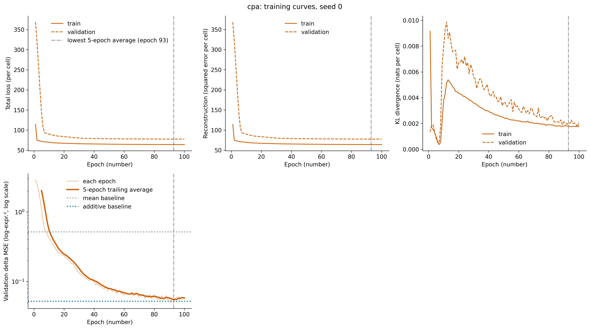
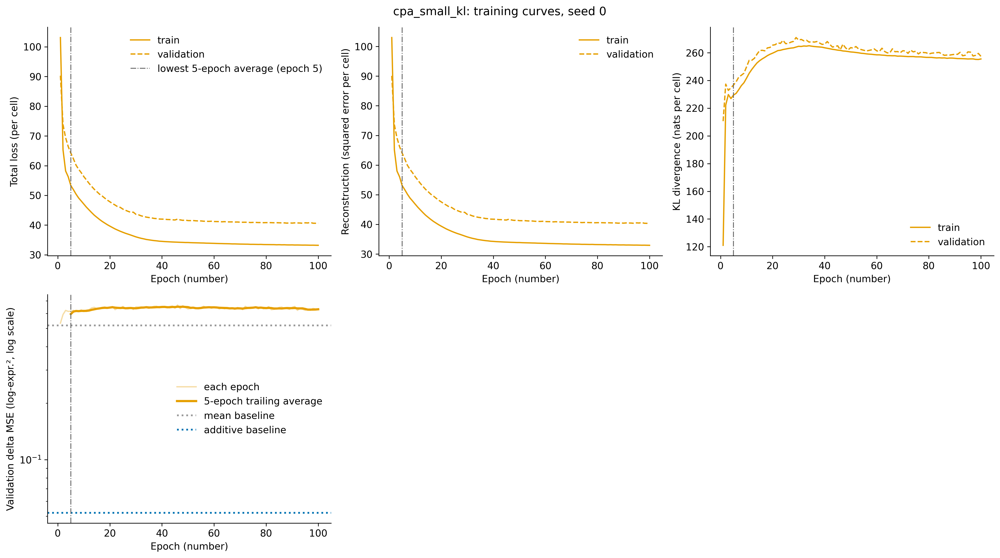
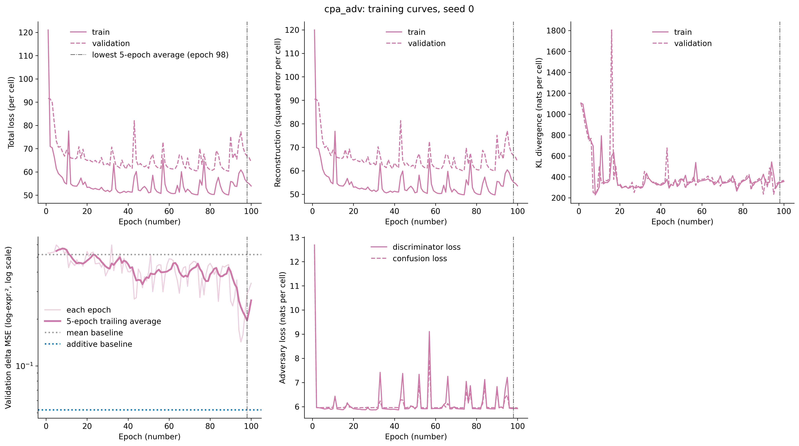

*Figure 3. Training curves of CPA variants.*

## Results

### Test set

All numbers are means over 39 test perturbations.
For CPA variants, the table shows the mean and standard deviation over 5 seeds.
The gene list includes the perturbed genes.

| Model | MSE | Pearson | Direction accuracy | Slope |
|---|---|---|---|---|
| additive | 0.045 | 0.960 | 0.996 | 1.004 |
| `cpa` | 0.057 ± 0.002 | 0.946 ± 0.002 | 0.990 ± 0.002 | 0.761 ± 0.023 |
| `cpa_adv` | 0.222 ± 0.073 | 0.721 ± 0.175 | 0.874 ± 0.094 | 0.280 ± 0.151 |
| mean | 0.289 | 0.538 | 0.862 | 0.165 |
| `cpa_small_kl` | 0.369 ± 0.007 | 0.142 ± 0.215 | 0.573 ± 0.090 | 0.014 ± 0.011 |

The gene list without the perturbed genes gives the same ranking.

| Model | MSE | Pearson | Direction accuracy | Slope |
|---|---|---|---|---|
| additive | 0.044 | 0.960 | 0.996 | 1.009 |
| `cpa` | 0.052 ± 0.002 | 0.952 ± 0.002 | 0.989 ± 0.002 | 0.773 ± 0.023 |
| `cpa_adv` | 0.210 ± 0.072 | 0.730 ± 0.182 | 0.868 ± 0.098 | 0.291 ± 0.159 |
| mean | 0.271 | 0.564 | 0.858 | 0.175 |
| `cpa_small_kl` | 0.352 ± 0.007 | 0.136 ± 0.210 | 0.567 ± 0.089 | 0.014 ± 0.011 |

The test MSE of each seed shows that the spread of `cpa_adv` comes from all five seeds.

| Seed | `cpa_small_kl` | `cpa_adv` | `cpa` |
|---|---|---|---|
| 0 | 0.3606 | 0.1885 | 0.0546 |
| 1 | 0.3762 | 0.1217 | 0.0550 |
| 2 | 0.3773 | 0.2200 | 0.0585 |
| 3 | 0.3639 | 0.3099 | 0.0584 |
| 4 | 0.3673 | 0.2697 | 0.0588 |

- Every `cpa` seed is worse than the additive baseline, which scores 0.045.
- Every `cpa_adv` seed is worse than every `cpa` seed.
- Seed 3 of `cpa_adv` is worse than the mean baseline, which scores 0.289.
- Every `cpa_small_kl` seed is worse than the mean baseline.

### Paired comparison with the additive baseline

A paired comparison scores two models on the same perturbation and looks at the difference.
CPA values are means over 5 seeds.
The interval is the 95% bootstrap interval of the mean difference.
It shows how much the result depends on which 39 perturbations are in the test set.

| Model | Metric | Better than additive on | Mean difference | 95% interval |
|---|---|---|---|---|
| `cpa` | Pearson | 18 of 39 | -0.0138 | -0.0279 to -0.0016 |
| `cpa` | MSE | 22 of 39 | +0.0120 | -0.0087 to +0.0353 |
| `cpa_adv` | Pearson | 0 of 39 | -0.2384 | -0.2771 to -0.2019 |
| `cpa_adv` | MSE | 1 of 39 | +0.1769 | +0.1376 to +0.2160 |
| `cpa_small_kl` | Pearson | 0 of 39 | -0.8179 | -0.8741 to -0.7558 |
| `cpa_small_kl` | MSE | 1 of 39 | +0.3240 | +0.2610 to +0.3873 |

For Pearson, a positive difference means CPA is better.
For MSE, a negative difference means CPA is better.

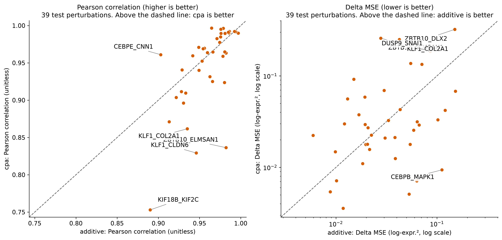

*Figure 4. Per-perturbation comparison of CPA with KL weight 30 and the additive baseline on the 39 test perturbations. CPA values are means over 5 seeds. Left: Pearson correlation. Right: delta MSE on log axes. The dashed line marks equal scores.*

The plots of the other two variants are shown below.
Both variants are worse than additive on almost every perturbation.

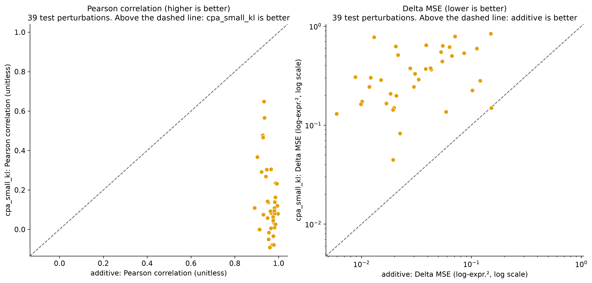
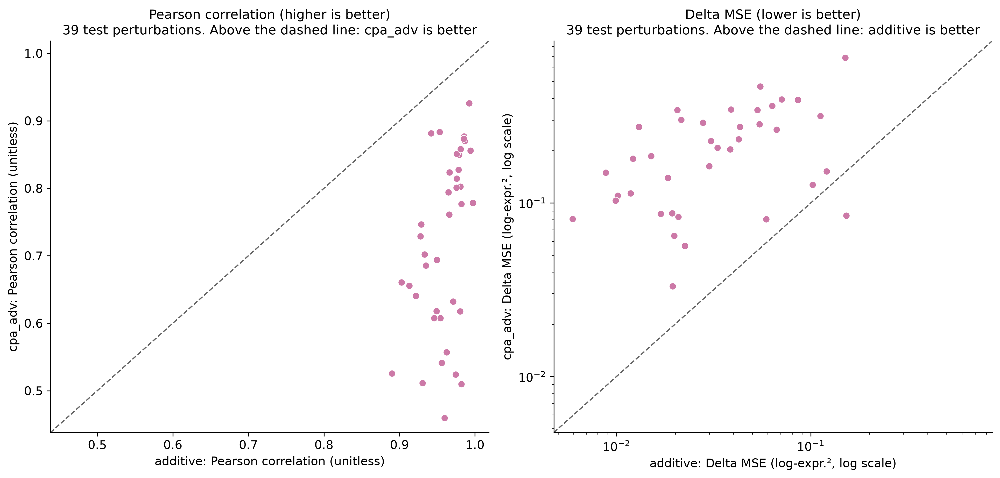

*Figure 5. Per-perturbation comparison of cpa_small_kl and cpa_adv and the additive baseline on the 39 test perturbations.*

### Where the MSE gap of `cpa` comes from

`cpa` has the lower MSE on 22 of 39 perturbations.
The median difference to additive is -0.002.
Its mean MSE is still higher, because a few perturbations have large errors.

| Perturbation | Additive MSE | `cpa` MSE | Difference |
|---|---|---|---|
| ZBTB10_ELMSAN1 | 0.0278 | 0.2584 | +0.2307 |
| KLF1_COL2A1 | 0.0425 | 0.2498 | +0.2072 |
| ZBTB10_DLX2 | 0.1502 | 0.3227 | +0.1726 |
| DUSP9_SNAI1 | 0.0858 | 0.1858 | +0.1000 |
| ZBTB10_SNAI1 | 0.0549 | 0.1371 | +0.0822 |
| ... | ... | ... | ... |
| SET_CEBPE | 0.1205 | 0.0421 | -0.0783 |
| ZC3HAV1_CEBPE | 0.1522 | 0.0680 | -0.0842 |
| CEBPB_MAPK1 | 0.1120 | 0.0094 | -0.1026 |

The sum of all 39 differences is 0.4666.
The two largest differences give 94% of this sum.
The mean difference without them is 0.0008.
We selected these two perturbations after seeing the plot.
This analysis is exploratory.

ZBTB10_ELMSAN1 and KLF1_COL2A1 are also the perturbations where the Pearson correlation of `cpa` falls furthest below additive.
For ZBTB10_ELMSAN1, the correlations are 0.836 for `cpa` and 0.982 for additive.
For KLF1_COL2A1, they are 0.862 for `cpa` and 0.935 for additive.
The analysis in the next section looks at these two pairs again.

### Similarity to training and genetic interaction

This analysis uses the predictions of all models on the 39 test perturbations.
The values of `cpa` are means over 5 seeds.

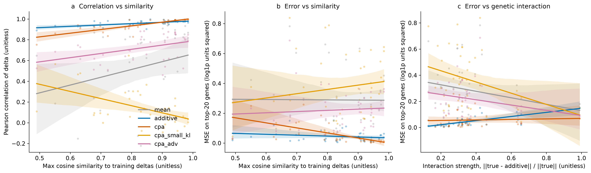

*Figure 6. Performance against similarity to the training deltas, a and b, and against interaction strength, c, for 39 test pairs. Lines are linear fits with 95% bootstrap bands.*

**Similarity.**
Test pairs have a similarity to training between 0.49 and 0.98.
The median is 0.85.

| Model | Pearson vs similarity | MSE vs similarity |
|---|---|---|
| additive | +0.50 [+0.22, +0.72] | -0.17 [-0.45, +0.14] |
| `cpa` | +0.84 [+0.66, +0.93] | -0.76 [-0.86, -0.59] |
| `cpa_adv` | +0.37 [+0.06, +0.62] | +0.18 [-0.16, +0.50] |
| `cpa_small_kl` | -0.49 [-0.69, -0.23] | +0.21 [-0.12, +0.52] |
| mean | +0.38 [+0.08, +0.62] | +0.07 [-0.26, +0.41] |

The table shows Spearman correlations with 95% bootstrap intervals over the 39 pairs.
The result for `cpa` is clear.
It predicts well for pairs that resemble a training perturbation and badly for pairs that do not.
The lowest-similarity pair is KIF18B_KIF2C, at 0.49.
The result for `cpa_small_kl` has no meaning.
This model predicts almost no shift, so its Pearson values are close to noise.

**Genetic interaction.**
The interaction strength of the test pairs has a median of 0.32.
One pair, ZC3HAV1_CEBPE, has 0.99.
The next pair has 0.66.
The trend lines in Figure 5c depend on this point.

| Model | Weak-interaction half | Strong-interaction half | MSE vs interaction |
|---|---|---|---|
| additive | 0.027 | 0.064 | +0.66 [+0.39, +0.82] |
| `cpa` | 0.057 | 0.057 | +0.26 [-0.05, +0.53] |

The table shows the mean MSE in each half and the Spearman correlation of MSE with interaction strength.
The additive error rises with interaction strength.
The error of `cpa` does not rise significantly.
The paired difference of MSE, `cpa` minus additive, is +0.030 in the weak half, with an interval of +0.001 to +0.063.
It is -0.007 in the strong half, with an interval of -0.034 to +0.023.
So `cpa` is worse than additive on pairs that are close to additive.
It is not different on strongly non-additive pairs.

**Scaled additive.**
The fitted factor is 0.796.
True double effects are on average about 20% smaller than the sum of the single effects.
The scaled prediction has a test MSE of 0.047, and the plain additive prediction has 0.045.
It lowers the error in the strong half, from 0.064 to 0.050, and raises it in the weak half, from 0.027 to 0.045.

**Residual correlation.**
For `cpa`, the correlation between the predicted and the true deviation from additive is +0.546, with an interval of +0.432 to +0.649.
Shrinkage alone gives a positive value, because the true effects are smaller than additive.
The mean baseline gets +0.185.
Against the scaled additive prediction, the value for `cpa` is +0.391, with an interval of +0.238 to +0.537.
It is still positive, so `cpa` captures some of the non-additive effect.
This does not make its MSE lower than that of additive.

### The worst-predicted pairs

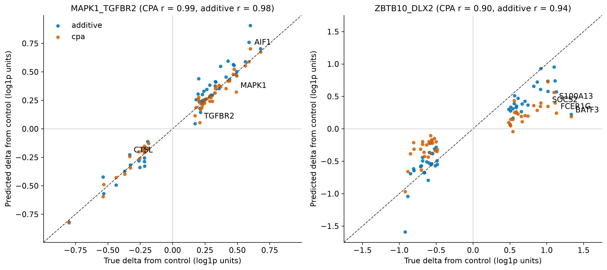

*Figure 7. Predicted against true delta for the top 50 genes of one well predicted pair, left, and one badly predicted pair, right. Both models are shown. The dashed line marks equal values.*

The best pair of `cpa` by MSE is MAPK1_TGFBR2.
Both models fit it well, with Pearson 0.989 for `cpa` and 0.980 for additive.
The worst pair is ZBTB10_DLX2, with MSE 0.323.
It is also the second-worst pair of additive.
In this pair, both models predict shifts that are much smaller than the true shifts.
For BATF3, the true shift is +1.33, additive predicts +0.22 and `cpa` predicts +0.19.
FCER1G, S100A13 and SOCS2 show the same pattern.
The pair has a stronger effect than the sum of its single effects.

| Pair | Why it is listed | Interaction strength | Rank of interaction (1 = strongest) | Training doubles with the genes |
|---|---|---|---|---|
| ZBTB10_DLX2 | Worst MSE of `cpa` (0.323) | 0.422 | 8 | 0 and 0 |
| ZBTB10_ELMSAN1 | Second-worst MSE of `cpa` (0.258) | 0.271 | 28 | 0 and 2 |
| KLF1_COL2A1 | Third-worst MSE of `cpa` (0.250) | 0.305 | 23 | 8 and 0 |
| KLF1_CLDN6 | Pearson of `cpa` 0.829, third-lowest | 0.294 | 26 | 8 and 0 |
| KIF18B_KIF2C | Lowest Pearson of `cpa` (0.753) | 0.656 | 3 | 0 and 0 |

The median number of training doubles per gene is 2.
Each of these five pairs contains a gene that appears in no training double.
Interaction strength does not explain the failures, except for KIF18B_KIF2C.
I did not test whether test pairs with such a gene are generally predicted worse.
Many test pairs may contain one.
So this is a hypothesis.

### Perturbation embeddings

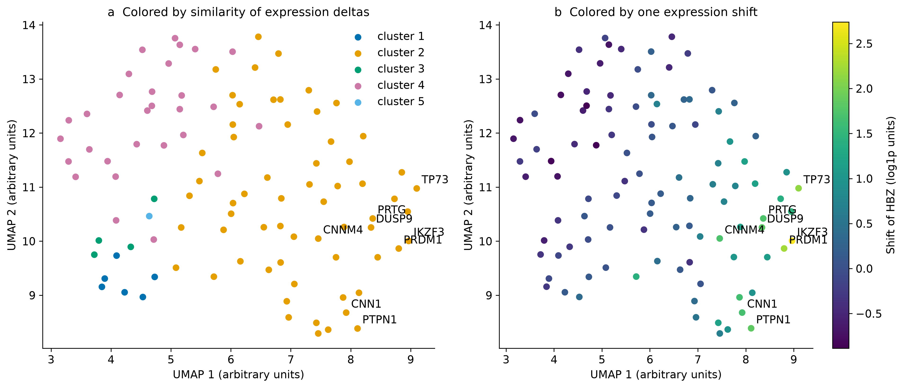

*Figure 8. UMAP of the 102 perturbation embeddings of `cpa`, seed 0. Left: color shows a cluster of similar expression deltas. Right: color shows the shift of HBZ. The axes have arbitrary units.*

For each seed, we correlated the pairwise cosine similarity of the embeddings with the pairwise cosine similarity of the single-perturbation deltas.
The p-value comes from 2,000 shuffles of the gene labels.

| Model | Spearman correlation, seeds 0 to 4 | p-value |
|---|---|---|
| `cpa` | +0.786 to +0.802 | 0.0005 in all seeds |
| `cpa_small_kl` | +0.023 to +0.044 | 0.04 to 0.18 |

This result is expected.
The embedding is trained to reproduce the deltas, so it is not independent evidence about biology.
It agrees with the collapse finding.
The small-KL model barely uses its embeddings.
The UMAP shows a continuous gradient and no separate groups.
One cluster holds 62 of the 102 genes.
TP73, PRDM1, IKZF3, DUSP9 and PRTG lie at one edge, and they have the largest HBZ shift.

## Interpretation

**Why the best CPA variant has a collapsed latent vector.**
The KL sweep shows a steady pattern.
When the KL weight rises, the latent information falls and the predicted shift rises.
The best scores come at weights where the KL divergence is close to zero.
A likely reason is that the encoder stores the perturbation effect in the basal latent vector of a perturbed cell.
Then the decoder does not need the perturbation embedding.
At prediction time, the encoder sees a control cell and the effect is missing.
The pattern in the sweep supports it.

**Why the adversary helps only partly.**
The adversary raises the slope of the small-KL model from 0.014 to 0.280 on the test set.
It does not reach the collapsed model.
Training is unstable.
The losses spike in single epochs, and the final epoch is a noisy sample.
At adversary weights 300 and 1000, the discriminator finds no perturbation information.
Yet the validation slope is only 0.31 and 0.55.
So the latent vector may hold information that this discriminator cannot read (a stronger discriminator might help).

**Why `cpa` predicts a smaller shift than additive.**
The slope of `cpa` is 0.761 and the slope of additive is 1.004.
The validation MSE of `cpa` was still falling at epoch 100.
Longer training might raise the slope.

## Reproduce

Install the package with `uv`.

```bash
git clone https://github.com/AidaKhaleghi/Perturbench.git
cd pertbench
uv venv
source .venv/bin/activate   # on Windows: .venv\Scripts\activate
uv pip install -e .
```

Run the pipeline in this order.

```bash
python -m pertbench.data.download
python -m pertbench.data.preprocess
python scripts/plot_overview.py
python scripts/train_variants.py
python scripts/plot_training.py
python -m pertbench.benchmark
python scripts/plot_results.py
python scripts/plot_per_perturbation.py
python scripts/export_predictions.py
python scripts/tables.py
python scripts/wrapup.py
python scripts/plot_generalization.py
python scripts/plot_gene_level.py
python scripts/plot_embeddings.py
```

The scripts need the checkpoints in `results/checkpoints/`.
The export step reads them and saves the predictions to `results/predictions/`.

- The benchmark writes one file for each run to `results/runs/`. A restarted benchmark skips finished runs.
- Training uses a GPU if one is available.

## Repository layout

```
src/pertbench/
    config.py          settings as dataclasses
    benchmark.py       runs all models and writes the results table
    analysis.py        similarity, interaction and residual helpers for Week 5
    data/              download, preprocessing, split, tensors
    models/            base interface, baselines, CPA module, CPA wrapper, variants
    eval/              top DE genes and metrics
    plotting/          shared style and one module per figure
scripts/               one script per figure, sweep or check
docs/                  prediction log and result tables
figures/               PNG at 300 DPI and SVG for every figure
```

## Future work

- **Adamson 2016.** I want to run the pipeline on a second dataset. 
- **GEARS-style variant.** I want to add a model that uses a gene graph. Gene co-expression from the training data would define the graph. This model can handle unseen genes.
- **Learned variance.** Add a per-gene variance to the decoder, as in the original CPA.

## References

- Norman et al., 2019. Exploring genetic interaction manifolds constructed from rich single-cell phenotypes. Science.
- Peidli et al., scPerturb: harmonized single-cell perturbation data. Nature Methods.
- Lotfollahi et al., Predicting cellular responses to complex perturbations in high-throughput screens. The CPA paper.
- Roohani et al., Predicting transcriptional outcomes of novel multigene perturbations with GEARS.
- Ahlmann-Eltze, Huber and Anders, 2025. Deep-learning-based gene perturbation effect prediction does not yet outperform simple linear baselines.
